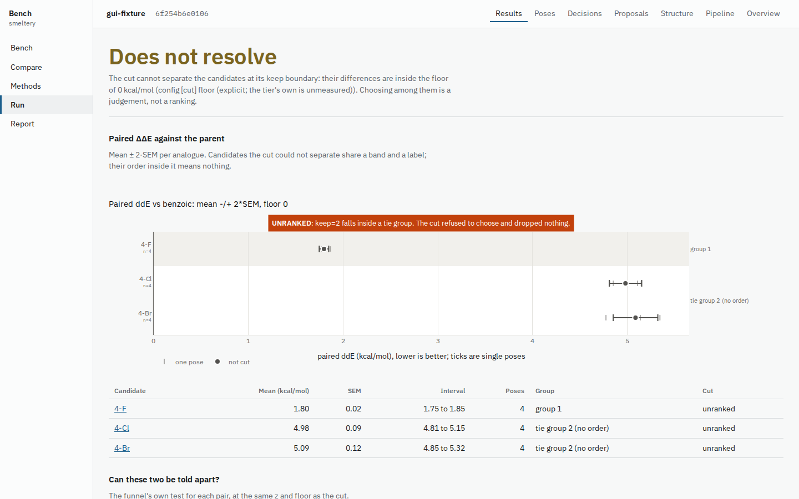
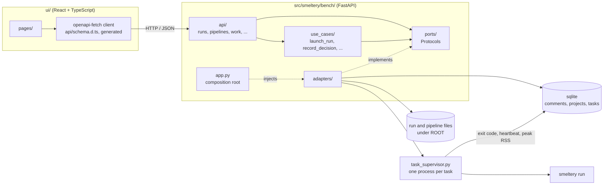

# smeltery

[](https://github.com/mgoldey/smeltery/actions/workflows/test.yml)
[](https://pypi.org/project/smeltery/)
[](https://pypi.org/project/smeltery/)
[](#license)

A tiered screening funnel for biochemical systems that ranks only what it can resolve, and
**Bench**, the local web app you read and run it from.

You give smeltery a lead compound and its analogues. It runs them through tiers of increasingly
expensive physics, keeps only the candidates that are measurably better, and says "unranked"
when two of them are within each other's uncertainty. It is for computational chemists who want
a ranking they can defend, and for the bench chemists who read the result. It runs on the
[ferric](https://github.com/mgoldey/ferric) quantum-chemistry engine.



*Bench's Results page on a small fixture run. The verdict is "Does not resolve": 4-Cl and 4-Br
share a tie group, so the cut refuses to order them.*

## 60-second demo

No quantum chemistry runs. This seeds a Bench directory with finished example runs and opens one.
From a source checkout, build the UI once first (needs Node); `pip install 'smeltery[bench]'`
ships it prebuilt.

```bash
(cd ui && npm ci && npm run build)
uv run --extra bench smeltery bench --demo --open
```

`--demo` copies all five prebuilt pipelines, each with its inputs and a finished run, into your
per-user Bench directory and opens on the `benzoic-rhf` run. It is idempotent: a second `--demo`
never overwrites your edits. Add a `ROOT` argument to use another directory. Details in
[docs/bench.md](docs/bench.md).

## Quickstart

You need Linux x86_64, Python 3.11 or 3.12, and [uv](https://docs.astral.sh/uv/). ferric
installs as a prebuilt wheel from PyPI, so you don't need a compiler.

```bash
git clone https://github.com/mgoldey/smeltery && cd smeltery
uv sync --extra dev
```

**1. Check the install (about 1 s, no SCF).** `--plan` builds the poses and the pocket and
estimates the cost. It runs no quantum chemistry.

```bash
uv run smeltery run examples/mwe_benzoic.toml --plan
```

It should end with `plan OK (no SCF run)` and an `input_digest`.

**2. Run the example (about 7 min on one core).** This runs benzoic acid and two
para-substituted analogues in a two-charge, arginine-like pocket. That's 6 paired poses per
candidate at RHF/STO-3G.

```bash
OPENBLAS_NUM_THREADS=1 uv run smeltery run examples/mwe_benzoic.toml --out out/benzoic
```

```
candidate  formula                paired ddE  unpaired SEM
benzoic    C7H6O2        +0.0000 ± 0.0000 kcal/mol             -
4-F        C7H5FO2       +1.8097 ± 0.0683 kcal/mol        1.2054
4-Cl       C7H5ClO2      +5.0243 ± 0.1228 kcal/mol        1.1959

cut (keep=1, z=2): survivors=['4-F'] | groups: [['4-F'], ['4-Cl']]
```

ΔΔE is each analogue's field interaction energy relative to the parent, on paired poses.
Electron-withdrawing substituents weaken binding to the cationic pocket, so Cl ranks worse
than F, in line with their Hammett σp values. The paired error bars are 10–17× smaller than
the unpaired ones. `out/benzoic/` is a self-contained run directory: the config as it was
run, copies of every input, the run record (`run-*.json`) and a per-SCF log.

**3. Look at it in a GUI (optional).** There are two. Both open in your browser.

- **`smeltery gui`** opens one run in a Marimo app with five tabs:
  - **Results**: the ΔΔE forest plot with tie groups and the cut, plus per-pose lines.
  - **Grid**: candidates, where you record keep/drop decisions with a reason.
  - **Pose**: each analogue pose overlaid on the parent's in Mol\*, with the receptor and
    the field charges.
  - **Compare**: runs side by side, per key.
  - **Pipeline**: a config builder.

  It needs only the `gui` extra, with no Node or build step. The browser does load Mol\* and
  RDKit.js from CDNs.

  ```bash
  uv run --extra gui smeltery gui out/benzoic
  ```

  To look at it before running anything, open a finished run that ships with the repo:
  `uv run --extra gui smeltery gui src/smeltery/prebuilt/benzoic-rhf/run`. Recording a
  decision there writes into the source tree, so copy the run elsewhere if you want to
  record decisions.

  Add `--no-browser` to only print the URL, for example on a remote machine with a forwarded
  port. Add `--desktop` (needs the `desktop` extra) to get a native window instead of a tab.
  More in [docs/gui.md](docs/gui.md).

- **`smeltery bench`** is a workspace for every run under a directory, and the place to build a
  pipeline from nothing. It opens on **Start here**, which offers three ways to start: copy one of
  five working pipelines (each with a finished example run), start from your own parent and
  analogues, or continue from a run you already have. From there you edit each step, choose a PDB
  from your computer for the active site, see what an edit will cost, and run it. In a source
  checkout you have to build its UI once first, which needs Node:

  ```bash
  (cd ui && npm ci && npm run build)
  uv run --extra bench smeltery bench out --open
  ```

  It works on an empty directory, so this is where to start when you have no runs yet:
  `mkdir work && uv run --extra bench smeltery bench work --open`.
  To see finished work without running anything: `uv run --extra bench smeltery bench --demo --open`
  seeds your per-user Bench directory with all five pipelines and opens a finished run.

**4. Start your own pipeline.**

```bash
uv run smeltery golden init --out myrun.toml --parent lead --parent-smiles "c1ccccc1C(=O)O"
# add analogue SMILES under [candidates] in myrun.toml, then:
uv run smeltery run myrun.toml --plan
uv run smeltery run myrun.toml --out out/myrun
```

[docs/golden-path.md](docs/golden-path.md) goes from there to a shareable bundle.

### Troubleshooting

The common failures (ferric compiling or missing wheels, `smeltery bench` exiting 2, `smeltery gui`
not finding a run, thrashing SCFs, exit codes 0/2/3/4 and `--force`) are in
[docs/troubleshooting.md](docs/troubleshooting.md), with the messages as the code prints them.

Running the tests and the other checks is covered in [AGENTS.md](AGENTS.md).

## What it does differently

- **Compares differences, never totals.** Total energies scale with molecular size, so
  ranking analogues with different formulas by total energy is meaningless. smeltery ranks
  a *paired* ΔΔE against the parent compound, and refuses to rank totals across formulas.
- **Pairs poses.** Each analogue pose *i* is built on parent pose *i*, so pose-to-pose noise
  cancels.
- **Admits when it can't tell.** If two candidates are within each other's uncertainty, the
  cut reports a tie, or "unranked", instead of an order.
- **Records provenance.** Every run writes a JSON record with the exact ferric commit, the
  settings and an input digest.

## How it works

A run is a pipeline of tiers. Each tier is a measurement with a stated cost and a stated claim
about what it may rank; the cheap ones go first.

1. **Poses.** `PairedPoses` builds an ensemble of parent poses (or takes docked ones). Each
   analogue pose *i* is built on parent pose *i*, with the shared core copied exactly, so pose
   noise cancels.
2. **Measure.** `FieldInteraction` computes each pose's interaction energy with the pocket's
   point-charge field. The difference from the parent is the paired ΔΔE.
3. **Cut.** The cut ranks candidates by mean paired ΔΔE, with its standard error and an explicit
   systematic floor. Candidates it cannot separate form a tie group with no internal order, and
   the verdict says so.

Optional gates (parity, PoseBusters, MMFF strain) either pass every candidate or stop the run;
only the paired-ΔΔE cut removes candidates. See [docs/tiers/index.md](docs/tiers/index.md) for
each tier, [docs/tiers/paired_poses.md](docs/tiers/paired_poses.md) for the pairing, and
[docs/worked-example.md](docs/worked-example.md) for one pipeline from its config to its numbers.

## Architecture

Bench is a FastAPI backend in `src/smeltery/bench/` with a React and TypeScript frontend in
`ui/`. The backend is ports and adapters: routes call use cases, use cases and routes depend on
port protocols, and `app.py` is the one place that picks concrete adapters. The frontend talks
to the backend only through a client generated from the backend's OpenAPI schema
(`npm run gen:api`), so a changed route is a type error in the UI rather than a runtime surprise.



- **`api/`** holds the routers (`runs`, `pipelines`, `work`, `lineage`, `methods`, `prebuilt`,
  `ligands`, `active_site`, `notebook`). They read the injected ports from `app.state`.
- **`use_cases/`** holds one module per operation, such as `launch_run`, `record_decision`,
  `compare_arms`, `publish_report` and `seed_demo`.
- **`ports/`** holds the protocols: `RunStore`, `PipelineStore`, `TaskQueue`, `CommentStore`,
  `ProjectStore`, `ArtifactStore`, `StructureSource`, `MethodDefaults`, `Identity` and `Clock`.
- **`adapters/`** implements them. Runs, pipelines and artefacts are files under ROOT; comments,
  projects and the task table are sqlite (`comments.sqlite`, `projects.sqlite`, `tasks.sqlite`).
  `SubprocessTaskQueue` hands each launch to a `task_supervisor.py` process, which owns the
  `smeltery run` child, reaps its exit code and writes status, heartbeat and peak RSS to sqlite
  itself. That is what makes a job's fate survive restarting the API: the server only reads the
  table and signals, so a queued run still starts, and a finished one is still recorded as
  finished, if Bench is restarted mid-flight. `TemporalTaskQueue` is the alternative backed by
  Temporal.

Tests can build the app with fakes for any port (`tests/bench/fakes.py`).

## Documentation

| To... | Read |
|---|---|
| Walk one pipeline from its config to its numbers | [docs/worked-example.md](docs/worked-example.md) |
| Go from a target to a shareable result | [docs/golden-path.md](docs/golden-path.md) |
| See what each tier computes, costs and may claim | [docs/tiers/index.md](docs/tiers/index.md) |
| Use the Bench web app | [docs/bench.md](docs/bench.md) |
| Use the Marimo GUI | [docs/gui.md](docs/gui.md) |
| Plug in structure, docking, scoring or potential providers | [docs/providers.md](docs/providers.md) |
| Run long work under Temporal | [docs/temporal-runs.md](docs/temporal-runs.md) |
| Set up optional environments (OpenMM, ML potentials) | [docs/environments.md](docs/environments.md) |
| Check measured limits | [docs/limits.md](docs/limits.md) |
| Fix an error message | [docs/troubleshooting.md](docs/troubleshooting.md) |
| Look up a term (ddE, floor, tie group, rung) | [docs/glossary.md](docs/glossary.md) |
| Check tool and data licences | [docs/licensing.md](docs/licensing.md) |

## Configs beyond the minimal example

`smeltery run` reads one TOML file. The shipped examples add one section at a time:

- **`[field_dft_interaction]`** measures with KS-DFT instead of RHF (for example
  `functional = "PBE"`; [tier page](docs/tiers/field_dft_interaction.md)). A config selects
  one of the two, never both. D3(BJ) is recorded per pose as `E_d3` and doesn't enter ΔE_int,
  because at a fixed geometry it's the same in and out of the field.
- **`[docking]`** (`examples/mwe_docking.toml`, needs the `docking` and `posebusters` extras)
  docks the parent with Vina and pairs the analogues to its docked poses. `[gates]` runs
  PoseBusters, an MMFF energy and strain record, and an xtb energy record before the SCFs.
  `[poses] relax_unmapped = true` relaxes only the new substituent, which otherwise fails
  PoseBusters at its junction with the copied core.
- **`[structure]`** (`examples/mwe_structure.toml`, same extras plus `pdb2pqr30`) starts
  from a target instead of a hand-prepared receptor. The structure can be a `.pdb` path, a
  PDB id, or an AlphaFold accession with `provider = "afdb"`; the last two need
  `allow_network = true`. smeltery prepares the receptor and centres the docking box on
  `center` or a `reference_ligand`. It cuts the point-charge field at `pocket_cutoff`, which
  is required because truncation is not monotone. Before any SCF it checks that the box,
  the field and the docked pose agree, and a failed check stops the run (exit 3).

  ```bash
  uv run --extra docking --extra posebusters smeltery run examples/mwe_structure.toml --out out
  ```

The config must state `[cut] floor` explicitly while `FieldInteraction`'s systematic floor is
unmeasured, and the run record notes this. The gates (parity, PoseBusters, and MMFF strain
when `[gates] max_strain_kcal` is set) either pass every candidate or stop the run. Only the
paired-ΔΔE cut removes candidates. `results.funnel` in the record gives each stage's
candidates in and out.

## Long runs: Temporal and the dashboard

For long work, Temporal is the system of record. smeltery keeps no process table or status
store of its own, so a task's status, timings and exit code outlive the worker that ran it. A
task runs at most once, because an arbitrary shell command isn't safe to re-run
automatically. A task whose worker died is reported as failed, and resubmitting it is your
decision. This needs the `temporal` extra and a reachable Temporal server (`--temporal-host`,
default `127.0.0.1:7233`), for example `docker run temporalio/temporal:latest server start-dev`.

```bash
uv run --extra temporal smeltery task-worker &             # executes submitted tasks
uv run --extra temporal smeltery dashboard out/ --port 8123 # runs, task status, task submission
```

If Temporal is down, the run list still works, and task operations return 503 or raise
`TemporalUnavailable` rather than quietly falling back. More in
[docs/temporal-runs.md](docs/temporal-runs.md).

## Correctness checks

`tests/test_anchors.py` checks the trivial limits, where the machinery must do nothing:

- A molecule paired with itself gives a ΔΔE of exactly 0.0 on every pose. The test also
  checks that the field is non-zero, so it can't pass vacuously.
- An empty field gives exactly zero interaction.
- An analogue's core coordinates are copied verbatim from the parent pose.
- smeltery's Å→Bohr conversion is exactly the one ferric uses, so point charges and atoms
  share one frame.

Each check was mutation-tested: breaking the pose copy, ranking a total energy, or passing
charges in Å each makes a test fail.

## Status

This is an early working example. The tier protocol, the paired-ΔΔE funnel, the
resolution-aware cut, the run record, the golden path, Bench, the dashboard and the Temporal
task layer all work end to end.

- Vina docking supports flexible receptor sidechains. Scores are an empirical ranking
  heuristic, not binding free energies.
- A force-field tier exists: MMFF in core, and OpenMM + OpenFF in an optional conda
  environment.
- `smeltery.tiers.Qmmm` is a single-point QM/MM tier with a real covalent cut. It needs
  ferric ≥ 0.1.0rc7 and has no geometry optimization yet.
- Only one stage is ranked (`FieldInteraction`), because its systematic floor is still
  unmeasured.

Measured limits, with sizes and sources: [docs/limits.md](docs/limits.md).

## License

Licensed under either of [MIT](https://github.com/mgoldey/smeltery/blob/main/LICENSE-MIT) or [Apache-2.0](https://github.com/mgoldey/smeltery/blob/main/LICENSE-APACHE), at your option.
