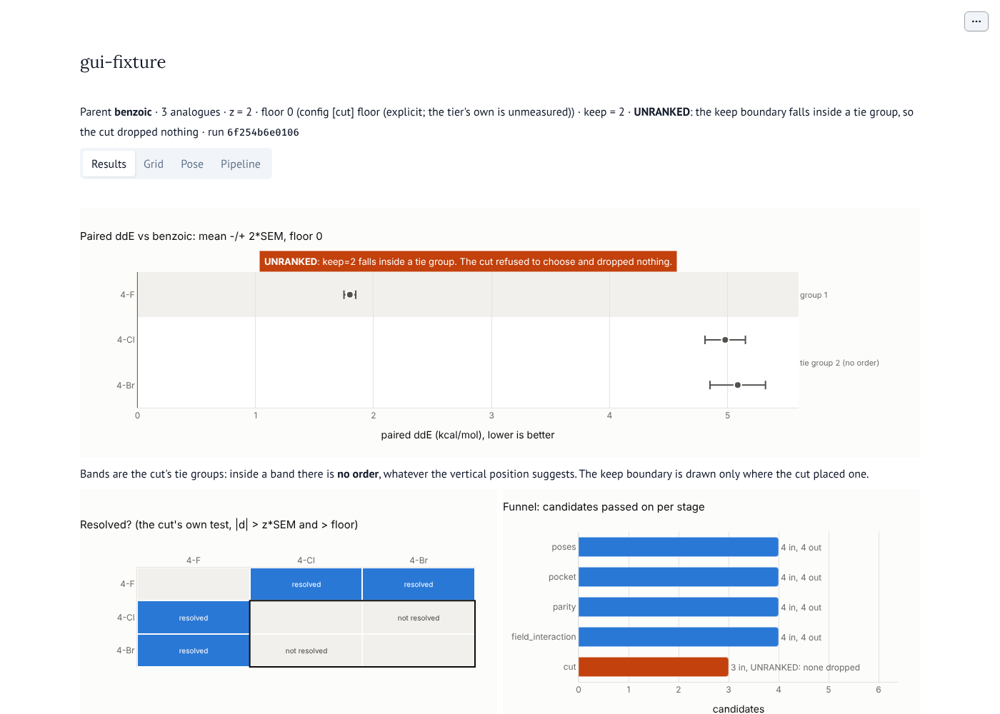
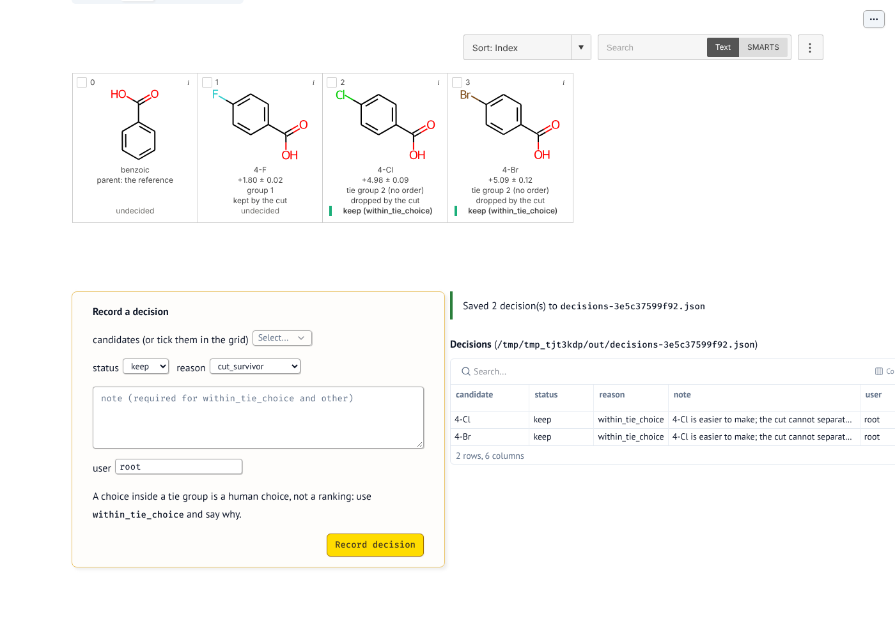
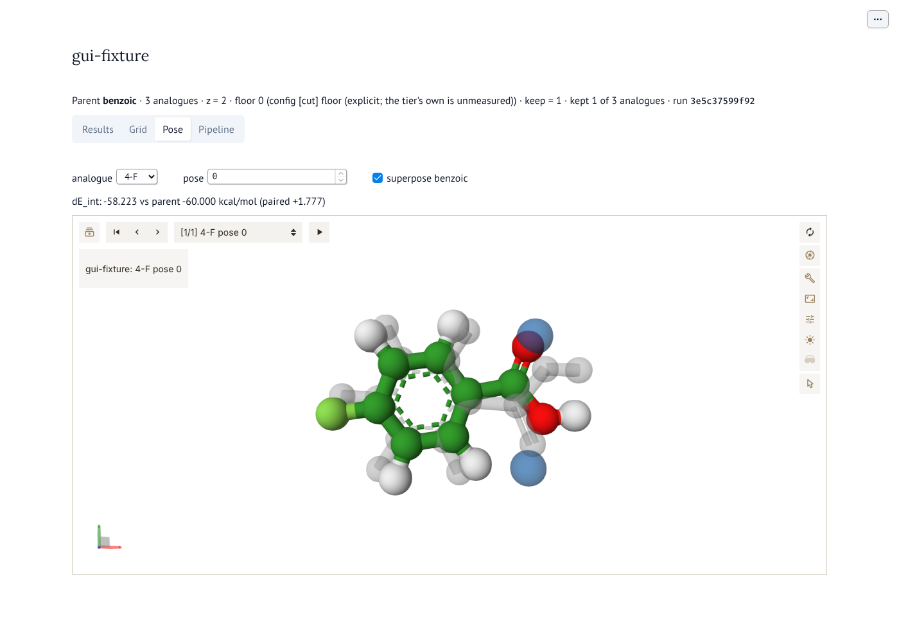
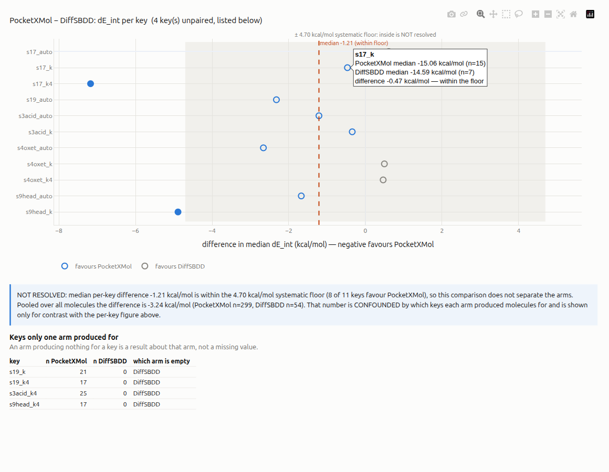

# GUI helpers: the method hierarchy as a pipeline

`smeltery.gui` is the layer under a pipeline builder. It does not import a GUI toolkit. A frontend (a notebook
widget, a Qt app or a web page reading `catalog_json()`) draws what it returns and calls it back.

## The model

A run is a pipeline of **stages**. Each stage is one **method** from the catalog. A method has:

- a **rung** on the method hierarchy, cheapest first: `input` → `geometry` → `check` → `empirical` →
  `semiempirical` → `ab_initio` → `embedded_qm` → `designable` → `decision`. `hierarchy()` returns the methods grouped
  by rung, which gives the palette.

  A rung is a **view of two independent things**, and `Method` exposes both. `phase` (`PHASES`) is *when* a stage
  runs — a real total order over the pipeline, in which `input` is not "less rigorous" than `geometry`. `rigour`
  (`RIGOUR`) is *how good the physics is*, and it orders methods **only within one `quantity`**: GFN2 is a cheaper
  estimate of the same `dE_int` as PBE, while a synthesizability heuristic is not a cheaper anything.
  `m.comparable_rigour(other)` is the predicate, and it is False across quantities — asking whether
  `field_dft_interaction` or `designability` is "more rigorous" is a category error. Note `surface_esp` is
  `ab_initio` too and still not comparable to `field_interaction`, because it measures `esp`, not `dE_int`.

  This is load-bearing for what the funnel is for. A candidate worth synthesising needs **affinity and buildability
  and safety**, which are different quantities. A single ladder forces them into one order and invites "scores
  better" to mean "is better" — which is how an unnormalised `dE_int`, a real but incomplete affinity proxy, comes
  to reward a generator for adding greasy mass.
- a **role** for the candidate list, using the same kinds `smeltery run` logs: `prep`, `search`, `pair`, `field`, `gate`,
  `recorded`, `measure`, `rank`. Only `rank` (the paired cut) removes candidates. A gate either passes everyone or
  stops the run.
- the **artefacts** it needs and provides: `receptor`, `field`, `parent_poses`, `poses`, `dE_int`, `survivors`. These are
  the edges a frontend draws between stages.
- typed **knobs** (`Param`: `int`, `float`, `bool`, `str`, `path`, `choice`, `vec3`, `int_list`, `str_list`, `sites`),
  so forms can be generated. Knob names are the config's own keys. The knobs for `PairedPoses` and `FieldInteraction`
  are read from the tier dataclasses at their own defaults.
- for a tier, what the tier declares about itself: produced quantities and units, systematic floors and
  `is_delta_g`.

Every registered tier is in the catalog. If `smeltery run` has no stage for a tier (`surface_esp`, `qmmm`,
`rescoring`), it appears with `wired=False` and the reason. The palette shows it but `addable()` does not offer it,
and `check()` refuses it.

## Editing and checking

```python
from smeltery.gui import Pipeline

p = Pipeline.minimal("demo", "benzoic", {"benzoic": "OC(=O)c1ccccc1", "4-F": "OC(=O)c1ccc(F)cc1"})
p.set("pocket", site=[{"q": 1.0, "atom": 0, "from_atom": 1, "distance": 3.0}])
p.set("cut", keep=1, floor=0.0)
p.add("forcefield")  # placed where smeltery run executes it; add(key, at=i) for a drop position
for issue in p.check():  # every issue at once: error / warning / note, each naming its stage
    print(issue)
print(p.to_toml())  # the config `smeltery run` reads; refuses (PipelineError) while errors remain
```

`check()` never raises. In order, it looks at:

1. Structure: unknown, duplicate, unwired or mutually exclusive methods, and required ones that are missing.
2. Dataflow: a stage placed before the stage that provides what it needs is an error. A reordering that moves no
   data, such as two gates swapped, gets a note giving the order `smeltery run` will actually use.
3. Knob types.
4. Advice: PoseBusters without `relax_unmapped` (a warning), and strain recorded with nothing rejected (a note). A cut
   without an explicit floor while the tier's floor is unmeasured is an error.
5. `smeltery.cli.validate_config` on the compiled config. The GUI keeps no second copy of the config rules, so a
   pipeline that checks clean is one the CLI accepts.

`Pipeline.from_config` / `from_toml` read a config back. Every file in `examples/*.toml` round-trips unchanged
(`tests/test_gui_pipeline.py`). `view()` returns one row per stage in execution order, including the implicit
parity gate, with the candidate count in and out for drawing the funnel.

## Not yet

- No cost per stage: tier `estimate_cost` needs posed candidates. Running `--plan` from the GUI would give real ones.
- One ranked stage only, as in `smeltery run`. A second ranker would need a measured floor, and none of the wired
  ones has one.

## Running the GUI

```sh
pip install 'smeltery[gui]'
smeltery gui OUT                      # OUT: a `smeltery run --out` directory, or its run-*.json
smeltery gui OUT --port 8123 --no-browser
smeltery gui OUT --desktop            # a desktop window instead of a browser tab: pip install 'smeltery[desktop]'
```

`smeltery gui` calls `smeltery.gui.app.main` (also `python -m smeltery.gui.app OUT ...`). It serves the Marimo app in
`smeltery/gui/views/notebook.py` on 127.0.0.1 with `marimo run`. That file is an ordinary Marimo notebook, so
`SMELTERY_GUI_OUT=OUT marimo edit src/smeltery/gui/views/notebook.py` opens it for editing (or pass `-- --out OUT`).
Without the extra, the command says what to install and exits 2. `import smeltery.gui` never needs the extra.

The app has five tabs:

- **Results**: the forest plot (paired ddE, mean ± z·SEM, in cut order), the "resolved?" matrix, the funnel and the
  per-pose paired lines. Tie groups are bands labelled "(no order)". The keep boundary is drawn only where the cut
  placed one; an UNRANKED cut is labelled across the plot instead. Nothing here decides more than `funnel.cut` did:
  the matrix is `funnel.resolved` with the run's own z and floor.
- **Grid**: every candidate with its ddE, tie group, what the cut did and its current decision. Tick candidates in
  the grid (or pick them in the form), choose a status and a reason, and press **Record decision**. Decisions are
  saved to `OUT/decisions-<input_digest[:12]>.json` by `smeltery.decisions.DecisionSet.dump`, all or nothing. Its
  validation refuses, for example, `within_tie_choice` or `other` without a note, and the app shows the refusal. An
  existing file that does not validate is reported and never overwritten.
- **Pose**: Mol\* showing analogue pose *i* with the parent's pose *i* superposed, the receptor when the run has
  one, and the field's point charges (`smeltery.gui.scenes.pose_scene`).
- **Compare**: several runs differenced **per key** instead of pooled. The runs offered are the directories
  beside this one that hold a `run-*.json` (`smeltery.gui.app.sibling_runs`); arms are picked, never inferred,
  because guessing which runs form an arm is how a comparison silently becomes a pooling of unlike things. The
  key is the run directory, its campaign or its parent. The floor band is the run's own systematic floor: a
  difference inside it is **not resolved** and its marker is drawn hollow, and the caption gives the pooled
  number labelled `CONFOUNDED` beside the per-key one, since the gap between them is the finding. Keys only one
  arm produced for are listed rather than dropped — an arm producing nothing for a key is a result about that
  arm. A per-key difference compares summary statistics over *different* molecules, so it carries no SEM and
  none is invented (`smeltery.gui.compare`).
- **Pipeline**: the builder above. It shows the palette by rung, the stages in execution order with each `check()`
  issue under its stage, a knob form per stage, and the config TOML. Until the pipeline checks clean, the TOML is a
  draft headed by what blocks it. The builder starts from the one `*.toml` in OUT if there is exactly one, else from
  `Pipeline.minimal` with the run's candidates and cut settings.

The browser loads Mol\* (pinned in `smeltery.gui.views.pose.MOLSTAR_VERSION`) and the grid's RDKit.js and jQuery
from CDNs, so it needs network access to them.









The Compare shot is the real gen-compare study: 9 of the 11 paired cells sit inside the ±4.70 kcal/mol floor band
and are drawn hollow, so only `s17_k4` and `s9head_k` are resolved. The median difference is −1.21 while the pooled
number is −3.24, which is why the caption carries both and labels the pooled one `CONFOUNDED`.
