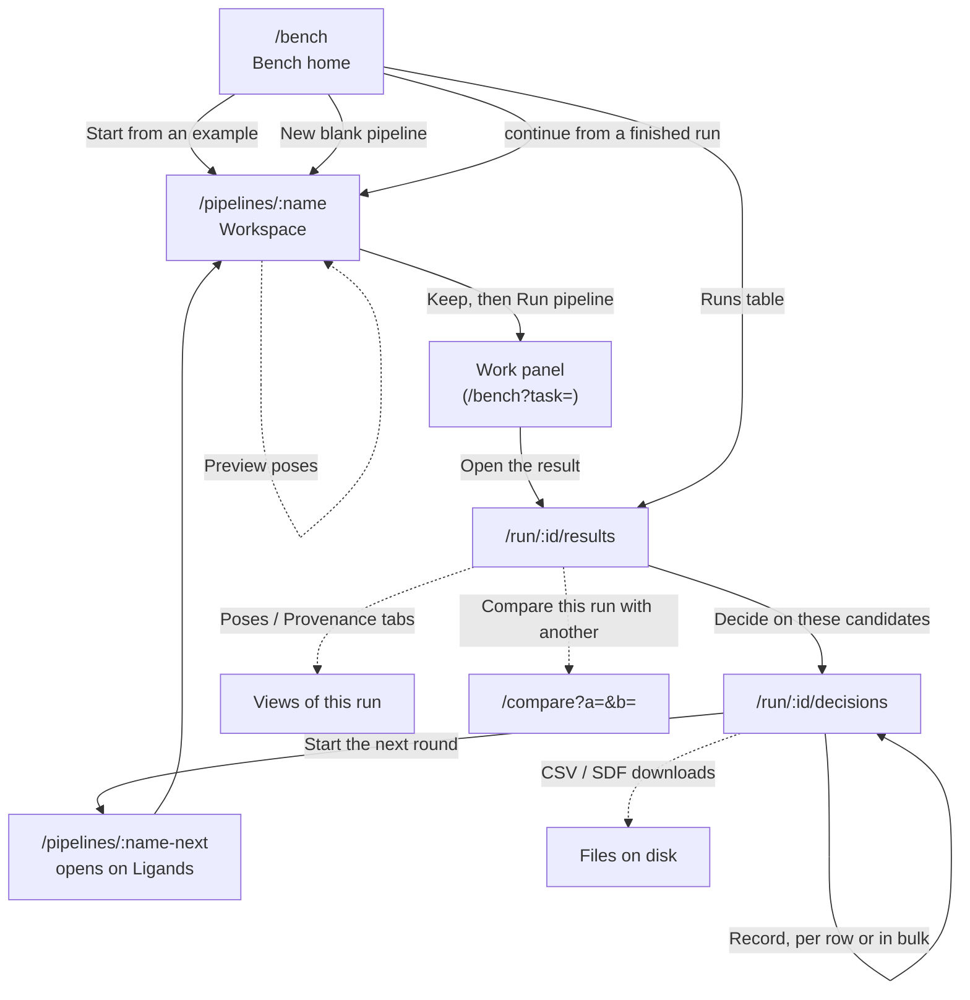
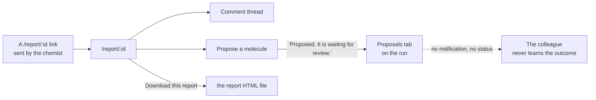
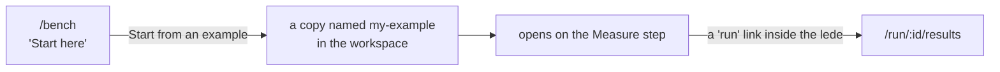
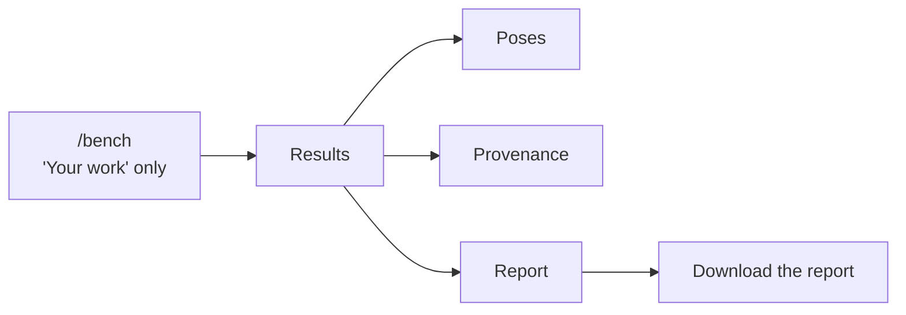
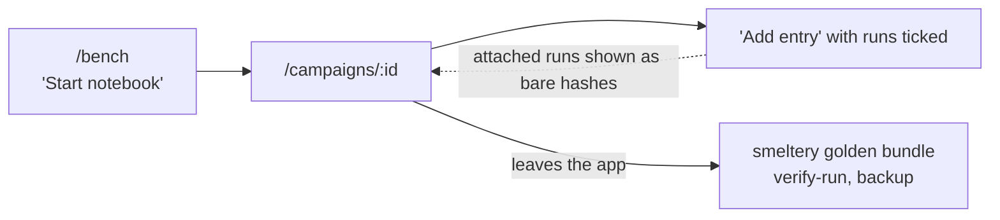

# User flows: who uses Bench, and the path each one takes

Who the Bench web app is for, the route each person takes through it, and where those routes break down. The
flows are drawn from the code, so each step names the control you actually click. A control is cited as
`file:line` wherever the label alone is ambiguous.

This page is about **movement through the app**. What each screen means is in [bench.md](bench.md); the
end-to-end path including its CLI steps is in [golden-path.md](golden-path.md); the survey of tools this UI
was designed against is in [gui-review.md](gui-review.md).

## The gap this page exists to name

Everything below describes the app as built, and most of it is a list of controls that could be better. One
finding is not like the others, and it is first because it is the one that matters:

**The step where a human most needs to look has no screen at all.**

`smeltery.generate` is a complete subsystem — DiffSBDD and PocketXMol fill a pocket, and every output the
generators decline is kept as a `Rejection` with a reason from a closed set, alongside `n_raw` and
`rejection_counts()`. **Bench cannot see any of it**: there is no reference to `GenerationResult`, `n_raw` or
`rejection_counts` anywhere under `src/smeltery/bench/`. A generative fill produces N molecules, the library
records exactly why each one was dropped, and the app shows none of that to anybody.

The same is true of the other cheap verdicts. All four answer one question — *is this candidate worth an
SCF?* — and they are visible at four different levels:

| Verdict | Recorded | Visible |
|---|---|---|
| Generator rejections | `GenerationResult.rejected`, 8 closed reasons, with SMILES | nowhere |
| Tox / structural alerts | `properties.RdkitAlertProvider` | nowhere; not in the run record ([gui-review.md](gui-review.md) says so) |
| PoseBusters gates | `results["posebusters"]`, named failing checks per pose | one step inside the pipeline editor, which `NeedsWrite` hides entirely on a read-only Bench |
| SCF drops | `results.dropped_poses` | `DroppedPoses` on Results — the one done right |

`DroppedPoses` is the pattern to copy: it says what was lost, why, and what it costs downstream. It was
built for the *last* and cheapest source of attrition and never for the three that come first.

Three consequences follow, and they are one problem rather than three:

1. **The pocket is generator input, not metadata.** Generation is conditioned on it, so "where is the active
   site" is the first question of a generative campaign. `/structure` cannot answer it; `ActiveSiteView` and
   `SitePlacer` live inside a pipeline step, so defining the generator's main argument requires already being
   inside a pipeline editor.
2. **The only human checkpoint sits after the expensive compute.** Decisions judges finished ΔΔE values.
   The cheap judgement that would prevent wasted SCF hours has nowhere to happen.
3. **Nothing shows a ligand in its pocket outside the pose viewer.** For a generated molecule this is not a
   preference: a generated ligand's meaning is how it sits in the pocket it was conditioned on, and a 2D
   sketch of it is nearly content-free. The Decisions table offers `pose_implausible` as a reason and no way
   to look at the pose.

What this implies — per-step review, a variable number of steps, one verdict surface, ligand always in
context — is a design question, not a defect list, and is not settled here.

Two facts a design will have to start from, both read from the code:

- **A gate-failed candidate leaves no geometry.** `_run_gates` records every per-pose verdict "whether or not
  a gate then rejects" (`cli.py:780`), so the *reasoning* survives — but the gate runs at `cli.py:809` and
  pose SDFs are written at `cli.py:1315`, and a `StageError` in between stops the run first. Showing a cut
  candidate in situ means persisting poses before the gate rejects.
- **A cut candidate's later gates never ran.** Once PoseBusters rejects, the later gates are skipped and are
  "simply absent from `results`". So strain and affinity are missing *because they were never evaluated*, not
  because they passed. Any table showing the four verdicts together must make "did not run" a state of its
  own, the way the app already separates "not ranked" from "not kept".

## The people

Five, distinguished by what they are trying to finish rather than by job title. Two of them never write
anything. A sixth — the chemist running a *generative* campaign — is absent from this list because the app
has no flow for them; that absence is the point of the section above.

| Who | Goal, and what "done" means | Lives on | Never touches |
|---|---|---|---|
| **The chemist running the series** | Screen a series, read the cut, decide, start the next round. Done when the next round's pipeline is open with the decisions carried. | `/bench`, `/pipelines/:name`, `/run/:id/*` | The propose form |
| **The colleague being asked** | Read the verdict, comment, propose a molecule. Done when the proposal is recorded. | `/report/:id` | Workspace, Methods, Decisions |
| **The first-time evaluator** | Find out what a result — and an *inconclusive* result — looks like here. Done after reading one worked example. | `/bench` "Start here" | Notebooks, Studies, Compare |
| **The reader of a published Bench** | Read results, poses and reports on a `--read-only` server. Done when the report is read or downloaded. | Results, Poses, Provenance, Report | Everything that writes |
| **The record keeper** | Archive what was decided and why, with hashes. Done when a bundle or notebook entry exists. | `/campaigns/:id`, Provenance, downloads | Pipeline editing |

Three screens serve two of these people at once, which is where most of the friction below comes from:
Bench home opens with the evaluator's examples above the chemist's own work; the Report page is the
colleague's whole app but only a tab to the chemist; and the Proposals tab shows the reader a list it gives
them no way to act on.

## The main loop

The spine of the app: screen a series, decide, iterate. Everything else hangs off it.

The loop closes: **Start the next round** creates a pipeline from this run's config with the decisions
referenced, and opens it on its candidate list. The original run is never modified.

### Where the loop leaves the app

Each of these is a point where the user must go to a shell and come back. They are listed because every one
of them is a place the flow can be lost.

| Leaves for | Why | Returns via |
|---|---|---|
| `smeltery temporal-worker`, `task-worker` | A durable run needs both workers started by hand ([temporal-runs.md](temporal-runs.md)) | The Work panel, once they are up |
| `smeltery run` again | Resuming an interrupted run; the UI's **Run pipeline** starts a new directory | The Runs table |
| `smeltery golden bundle` | There is no run bundle in the UI | A file on disk |
| `smeltery avogadro` | External 3D inspection | Nothing |

## The colleague's flow

The shortest flow in the app, and the only one that is a single page.

The dashed edge is the flow's one real break: a proposal is recorded and then goes quiet. Nothing on the
Report page reports back, and the queue it lands in is on a page this person does not visit.

## The evaluator's flow

This person was promised a result and is handed a pipeline editor. The example ships with a finished run,
but the way to that run's numbers is a link inside a paragraph of body text, not a control.

## The reader's flow (`--read-only`)

Write-only tabs are hidden and every write is refused by one middleware, so this flow cannot reach a
refusal by accident. What it can reach is a page whose text describes controls it cannot see.

## The record keeper's flow

## Pain points

Secondary to the gap above: these are defects in screens that exist, not missing screens. Four of them are
fixed (see the end of this page); the rest are recorded as found.

Each one names the control, or the control that should exist and does not. Grouped by what kind of problem
it is, worst first within each group. Where a claim is read from the code but has not been watched in a
running app, it says so.

### A flow that dead-ends or detours out of the app

1. **`/structure` is unreachable and has no way out.** No control anywhere in `ui/src` links to it; it is
   reachable only by typing the URL or through the legacy `/run/:id/structure` redirect
   (`ui/src/App.tsx:74`, `:97`). The page renders no `Shell` (`ui/src/pages/run/Structure.tsx:31`), so it
   has no rail to leave by, and it offers no way to use the structure it just opened in a pipeline.
   [bench.md](bench.md) still describes opening a structure as the first thing a chemist does.
2. **A failed or interrupted run cannot be resumed from the UI.** The task inspector offers only **Cancel
   task** (`ui/src/components/WorkPanel.tsx:272`), and **Run pipeline** defaults to a new dated directory,
   so pressing it again starts the work over rather than resuming. The way back is to copy the `--out` path
   out of the task's command, or to use the CLI.
3. **No run bundle in the UI.** The record keeper's one deliverable is a CLI command. "Download saved
   bundle" in the workspace is the *pipeline*, not the run (`ui/src/pages/run/Workspace.tsx:373`).
4. **Study cells are view-only.** Each cell shows "to run" with no control to run it
   (`ui/src/pages/Study.tsx:95`), and the page exists only when Bench was started with `--study`.

### State lost between screens

5. **The launch-to-result link lives only in component state.** **Open the result** exists only while the
   Launch component stays mounted (`ui/src/components/workspace/Launch.tsx:58`). "Follow it in Work"
   navigates away and destroys it, and neither the Work table nor the task inspector links to the run that
   was produced. The user then picks their run out of a table whose rows carry no date, out-directory or
   pipeline (`ui/src/pages/BenchHome.tsx:369`) — two rounds of one campaign differ only by digest and
   candidate count. The same ambiguity shows up in the Compare arm pickers
   (`ui/src/pages/Compare.tsx:57`) and the "start from a run" picker (`BenchHome.tsx:313`).
6. **A pipeline forgets its runs.** The pipeline list links to `/pipelines/:name` with no `?run=`
   (`BenchHome.tsx:342`), and so does Methods' "Used by" (`ui/src/pages/Methods.tsx:163`). Without it the
   Poses, Checks, ΔE_int and Cut views all report that the step has not run and tell the user to "open this
   pipeline from a run (or run it)" (`ui/src/components/workspace/views/PosesView.tsx:24`) — even for an
   example that ships with a finished run. Nothing sets `?run=` after a launch, so "or run it" does not
   make the advice come true. *Read from the client; whether the server could infer the run was not
   checked.*
7. **"Open the pipeline" does not open the pipeline that made the run.** The name is computed in the
   browser as `<campaign>-<digest8>` and created if it is absent
   (`ui/src/components/workspace/openFromRun.ts:7`, `:26`). A run launched from a pipeline the user named
   themselves therefore opens a *second*, digest-named pipeline beside it. This follows from a deliberate
   design decision — runs "keep their own staged copy and record no pipeline name"
   (`src/smeltery/bench/api/pipelines.py:562`) — so closing it means recording provenance the design
   currently leaves out, not just relabelling a button.

### A missing affordance

8. **Deciding has no progress, no undo, and a partial exit.** There is no "n of N decided" anywhere, and
   **Start the next round** appears as soon as one decision is recorded
   (`ui/src/pages/run/Decisions.tsx:255`), with no warning about rows that were edited but never recorded.
   A decision cannot be cleared: the API has POST and bulk POST only, and no `DELETE` route exists anywhere
   in the Bench API — which is consistent with decisions being an auditable record, but leaves a
   mis-click permanent. The next-round hook accepts `drop` and `carry_decisions`
   (`ui/src/components/workspace/openFromRun.ts:66`) and no control passes either. Rows offer no link to
   the candidate's poses, though `pose_implausible` is one of the reasons on offer.
9. **Tie-group judgement is described more strictly than it is enforced.** The Decisions lede says that
   choosing inside a tie group "needs a note saying why" (`Decisions.tsx:188`), but the only rule is that a
   note is required when the *reason* is `within_tie_choice` or `other`
   (`src/smeltery/decisions.py:39`). Keeping one member of a tie group as `cut_survivor` with no note is
   accepted. The reason list is identical on every row and is never tied to whether that row is in a tie
   group. *That users actually mis-pick the reason is an inference; the missing rule is verified.*
10. **The next round does not say what it carried in.** Nothing in `ui/src` renders
    `decisions_in.excluded`, and Provenance shows neither the verdict nor the decisions hash
    (`ui/src/pages/run/Overview.tsx:34`). The only trace of what was dropped is a header comment inside the
    config text.
11. **The chemist/colleague conversation is one-way.** Comments live only on the Report page and are
    invisible from every Run tab; the Proposals tab carries no count (`ui/src/pages/run/RunLayout.tsx:14`);
    and a proposal has no lifecycle, which the code says in as many words
    (`ui/src/pages/run/Proposals.tsx:79`).
12. **Record-keeping is disconnected.** The notebook lists attached runs as bare hashes rather than links
    (`ui/src/pages/Notebook.tsx:136`), run pages never link back to a notebook, and decisions are never
    offered to one even though the notebook's own empty state asks the user to "record what you decided and
    why".

### A control that exists but misleads

13. **Read-only leftovers.** Proposals shows tick boxes and tells the reader to "tick the ones you agree
    with" while the only button is hidden (`ui/src/pages/run/Proposals.tsx:30`), and its empty state sends
    them to a Report page where proposing is also hidden. The Work panel's text still talks about
    cancelling work (`ui/src/components/WorkPanel.tsx:94`).

## Already addressed

Fixed from the list above: **1** (`/structure` has its own Shell and a rail entry), **8** in part (Record and
bulk Apply hold until a required note is typed, and say which reason is waiting), **13** in part (failed reads
now say so instead of rendering as "there is none" — Results, Report, Study, Proposals, Notebook, Limits), and
the two unguarded write buttons in the lineage panel.

Found and fixed alongside them, in the core rather than the UI: `funnel.cut()` grouped candidates by comparing
each to the previous group's *last* member. Non-significance does not chain, so a run of unresolved neighbours
collapsed into one group even when its endpoints were resolved — reporting UNRANKED and discarding a
distinction the statistics support. Candidates are now compared against every member of a group they would
join.

Recorded so they are not re-reported: Results links into Compare, Methods carries the limits table,
Provenance shows the run's commented config, the report downloads without writing to disk, each decision row
shows its own mean ± SEM, and a second next-round from one run gets a unique name.
